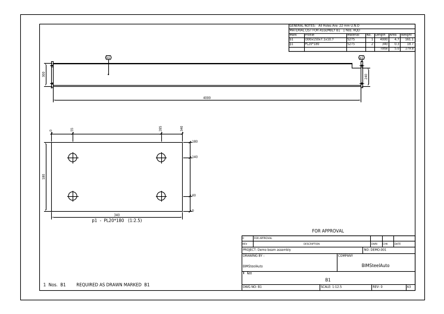
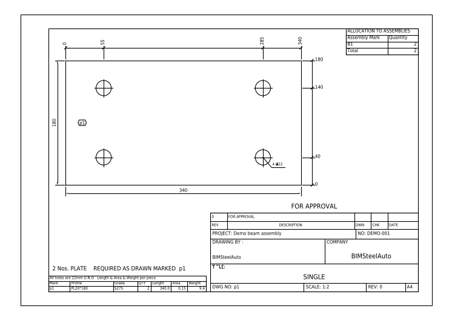

# BIMSteelAuto - FreeCAD Workbench for Steel Buildings

**From building parameters to a designed, detailed and quantified steel
building - in one click inside FreeCAD.**

BIMSteelAuto is a **FreeCAD workbench** for Pre-Engineered Buildings (PEB)
and steel portal frames. Enter the building (span, bays, eave height, roof
slope, cladding) and five wind inputs, press **Build model**, and it
produces:

- a designed **3D BIM model** of every member and connection
- **calculation sheets** with every limit state and clause reference
- **fabrication drawings** - general arrangement sheets, assembly and
  single-part shop drawings (DXF / PDF) and plate NC files (DXF + DSTV),
  produced from the IFC behind three automatic quality gates
- a **material take-off (MTO)** - member schedule, piece count and tonnage,
  counted off the model that was actually built
- an **IFC4** export with a proper Site / Building / Storey tree

## The FreeCAD workbench

Pick **BIMSteelAuto** from FreeCAD's workbench selector. Its commands:

| Command | What it does |
|---|---|
| **Build model** | Runs the full chain: loads, analysis, design, connections, 3D model, drawings, MTO, IFC |
| **Design status** | Shows each member's utilisation and whether every check is verified |
| **Result contours** | Draws displacement, stress and AISC utilisation on the 3D model |
| **Open output folder** | Opens the calc sheets, drawings, MTO and IFC |
| **Settings** | Points the workbench at the package folder |

## Build from text with Claude

BIMSteelAuto ships with an **MCP connection** that lets Claude Code (or
Claude Desktop) drive a live FreeCAD session. Describe the building in
plain words and Claude fills in the job, runs the design, sizes the
members until they pass, and builds the model, drawings and MTO in
FreeCAD while you watch:

> *"Design a 24 x 36 m PEB warehouse in Muscat: clear span, 6 m bays,
> 6 m eave, 1:10 gable roof, sandwich panel roof, enclosed, V = 45 m/s,
> Exposure C, Risk Category II. Build it in FreeCAD and give me the
> tonnage."*

To set it up:

1. Run `rpc_server.FCMacro` inside FreeCAD (it listens on 127.0.0.1 only)
2. Open Claude Code in this repo folder - `.mcp.json` connects it
   automatically, and `CLAUDE.md` tells Claude the workflow

Full steps, Claude Desktop setup and security notes: `mcp/README.md`.

## What it designs

1. **Loads** - ASCE 7-16 load combinations, and the Ch. 28 envelope wind
   procedure from five site inputs (V, exposure, enclosure, Kzt, risk
   category)
2. **Analysis** - second-order (P-Delta) frame analysis with PyNite
3. **Members** - AISC 360-16 hot-rolled and built-up frames (via
   [pyaisc360](https://github.com/ahmedalisteel-star/pyaisc360)) and
   AISI S100-16 cold-formed purlins and girts
4. **Connections** - moment end plates (4E / 4ES / 8ES, AISC DG 4), base
   plates (AISC DG 1), anchors (ACI 318-19 Ch. 17), welds and column-side
   checks (AISC J2 / J10), purlin cleats and bracing gussets

## Fabrication output

- **Shop model** - the analysis stick model is turned into a fabrication
  model: members trimmed at the knee and apex, end plates, cleats, girts and
  eave struts placed where they are built, with a **clash check** (zero hard
  clashes is a release condition)
- **GA drawings** - frame elevation, side elevation and roof plan sheets
  with title block, scale and marks
- **DXF drawing set** (`bsa_dxf`) - border, title block, grids, dimensions,
  member marks, taper schedule and connection details; runs without
  FreeCAD, so a drawing office can use it on its own
- **MTO** - member schedule by mark with pieces, lengths and tonnage, taken
  off the built model rather than the design, so nothing is under-counted

### Gated fabrication drawings from IFC (`bimsteelauto.fabdraw`)

No dimension, hole position, mark or quantity on a shop drawing is typed by
anyone. Every number is computed from the IFC geometry, and every sheet is
read back and checked against the IFC before it can be issued:

```
IFC -> G1 clash -> G2 data (IDS) -> generate DXF -> G3 round-trip -> ISSUE
```

| Gate | What it checks | Blocks issue when |
|---|---|---|
| **G1 clash** | hard clashes between parts (ifcclash) | any hard clash |
| **G2 data** | every part and assembly has its mark, every member its profile, every plate its thickness, every bolt its diameter and length (IDS rules in `fabrication_ready.ids`) | data is missing |
| **G3 round-trip** | every dimension and hole on every sheet, read back against the IFC | a drawn value does not match the model |

Every sheet is drawn **NOT FOR ISSUE** and re-stamped **FOR APPROVAL** only
after the gates pass. Each gate writes a JSON + HTML report, and the clash
gate also writes a BCF file you can open in any BIM viewer.

```powershell
python -m bimsteelauto.fabdraw.run MODEL.ifc OUT_DIR --pdf
```

Output: one assembly sheet per assembly mark (A3), one single-part sheet per
part mark (A4), plate cutting outlines (NC DXF + DSTV `.nc1`), a drawing
register (CSV + HTML) and the gate reports. It also accepts an IFC from
Tekla or another tool (`--policy any`).

Sample output, generated by the pipeline from a test model:





## Verified against independent tools

A connection type is not marked ready for issue until it matches an
independent reference. Every sheet prints **NOT FOR ISSUE** while any check
is still unverified.

| Module | Reference | Agreement |
|---|---|---|
| End plate 4E / 4ES / 8ES | CET.SteelConnDesign | within 0.02% (4E) |
| Anchors, all failure modes | Hilti PROFIS Engineering, ACI 318-19 | within 1.63% |
| Base plates | AISC Design Guide 1, 2nd ed. | direct |
| Wind, Ch. 28 envelope | Struware ASCE 7-16 | see tests |
| Frame analysis | anastruct (second solver) | see tests |
| Section properties | sectionproperties (FEM) | see tests |

The reference values live in `tests/fixtures/`. 1,032 tests pass.

## Layout

```
BIMSteelAutoWB/            the FreeCAD workbench
bimsteelauto/              engine: spec, loads, analysis, design, report (no FreeCAD import)
bimsteelauto/fabdraw/      IFC -> gated fabrication drawings, NC files and drawing register
bimsteelauto_connections/  connection design: bolts, endplate, welds, baseplate, anchors, secondary
bimsteelauto_fc/           FreeCAD adapter: shop model, drawings, MTO schedule, IFC, contours, clash check,
                           and the bridge to the parametric peb_building_param_v8 macro (v8.py)
bsa_dxf/                   DXF fabrication drawing set (ezdxf only)
bsa/                       command line tool
vendor/                    vendored cold-formed engine and verification references
mcp/                       Claude <-> FreeCAD MCP bridge (build projects from text)
docs/images/               README images
tests/                     pytest suite, including verification against the tools above
CLAUDE.md                  build-from-text workflow that Claude Code follows
```

## Install

Requires Python 3.12 or newer and FreeCAD 1.1.

```powershell
git clone https://github.com/ahmedalisteel-star/bimsteelauto.git
cd bimsteelauto
python -m pip install -r requirements.txt
python run_frame_example.py     # designs a demo frame and writes design_result.json
python -m pytest
```

Then link the workbench into FreeCAD and restart it:

```powershell
New-Item -ItemType Junction -Path "$env:APPDATA\FreeCAD\Mod\BIMSteelAutoWB" -Target "$PWD\BIMSteelAutoWB"
```

Choose **BIMSteelAuto** in the workbench selector and use **Settings** to
point it at the repo folder. See `USER_GUIDE.md` and `SETUP_NEW_PC.md`.

## Status

Active development. Results are engineering aids and must be checked by a
qualified engineer before use on a real project.

## Author

**Ahmed Ali** - structural engineer and BIM specialist, AI automation for
steel structures.

## License

MIT - see `LICENSE`.
